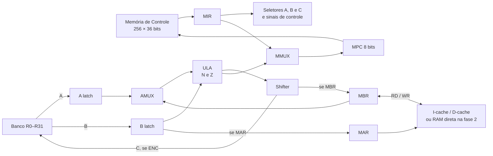

# Microarquitetura MIC-3 planejada

Esta página descreve o caminho de dados da fase 2 e as extensões planejadas. O simulador já executa as 79 microinstruções de [mic1.masm](../tools/microcode/mic1.masm) pela Memória de Controle; pipeline e caches ainda não estão implementados. A [ISA](isa.md) define as instruções visíveis ao programa.

## Caminho de dados

`MAR` e `MBR` são a interface com a memória. O bit `IF` do MIR encaminha uma leitura de instrução à I-cache; outras leituras e escritas vão à D-cache. Na fase 2, sem caches, ambos chegam à RAM. A Memória de Controle é separada e nunca passa pelas caches de programa. [Memória e caches](memory.md) descreve latência, stalls e E/S.

## Registradores e estado inicial

O banco possui 32 registradores de 32 bits. Os seletores A, B e C têm 5 bits cada.

| Índice  | Nome   | Valor após `RESET` | Uso                                 |
| ------- | ------ | ------------------ | ----------------------------------- |
| R0      | ZERO   | `0`                | Constante; escritas ignoradas       |
| R1      | PC     | `0`                | Endereço da próxima macroinstrução  |
| R2      | AC     | `0`                | Acumulador da ISA                   |
| R3      | SP     | `0xFFC`            | Pilha descendente                   |
| R4      | IR     | `0`                | Macroinstrução corrente             |
| R5      | TIR    | `0`                | Cópia temporária para decodificação |
| R6      | ONE    | `1`                | Constante, somente leitura          |
| R7      | MONE   | `0xFFFFFFFF`       | Constante −1, somente leitura       |
| R8      | AMASK  | `0x00000FFF`       | Máscara do campo `x`                |
| R9      | SMASK  | `0x000000FF`       | Máscara do campo `y`                |
| R10–R15 | A–F    | `0`                | Temporários do microprograma        |
| R16–R31 | livres | `0`                | Reservados para uso interno futuro  |

Os latches A, B, MAR, MBR e MIR, o MPC e as flags N/Z começam em zero. O MPC endereça 256 palavras de 36 bits. A e B capturam os operandos selecionados pelo banco antes da operação da ULA; as escritas do barramento C e dos latches habilitados ocorrem na borda de clock. Não há escrita arquitetural em R0 nem em R6–R9.

## Palavra de controle de 36 bits

O bit 35 é o mais significativo. Campos não usados por uma micro-operação são codificados como zero. A ordem abaixo fixa também o empacotamento do futuro `ctrl.bin`.

| Bits  | Campo | Codificação / efeito                                                                            |
| ----- | ----- | ----------------------------------------------------------------------------------------------- |
| 35    | AMUX  | `0`: A latch; `1`: MBR como entrada A da ULA                                                    |
| 34:33 | COND  | `00`: MPC+1; `01`: ADDR se N; `10`: ADDR se Z; `11`: ADDR sempre                                |
| 32:31 | ALU   | `00`: A+B; `01`: A AND B; `10`: A; `11`: NOT A                                                  |
| 30:29 | SH    | `00`: sem deslocamento; `01`: direita lógica 1 bit; `10`: esquerda lógica 1 bit; `11`: inválido |
| 28    | MBR   | `1`: escreve saída do shifter em MBR                                                            |
| 27    | MAR   | `1`: escreve o valor do B latch em MAR                                                          |
| 26    | RD    | `1`: solicita leitura de memória                                                                |
| 25    | WR    | `1`: solicita escrita de memória                                                                |
| 24    | ENC   | `1`: escreve a saída do shifter no registrador C                                                |
| 23:19 | C     | Índice do registrador de destino                                                                |
| 18:14 | B     | Índice do registrador-fonte B                                                                   |
| 13:9  | A     | Índice do registrador-fonte A                                                                   |
| 8:1   | ADDR  | Endereço de desvio na Memória de Controle                                                       |
| 0     | IF    | `1`: `RD` é busca de instrução; `0`: acesso a dados                                             |

`RD` e `WR` juntos são inválidos. `IF=1` exige `RD=1` e `WR=0`. A ULA calcula N a partir do bit 31 e Z quando o resultado é zero, **antes** do shifter. `COND` usa essas flags da micro-operação corrente; se a condição falha, o MPC avança módulo 256. `MAR` recebe B, enquanto C e MBR recebem a saída do shifter. Uma escrita no MBR e um `RD` simultâneos dependem do interlock de memória; o resultado da leitura só pode substituir MBR quando estiver pronto.

Cada palavra de `ctrl.bin` ocupa **5 bytes little-endian**: bits 0–35 da microinstrução e quatro bits altos zerados no quinto byte. O arquivo pode conter até 256 palavras; endereços não fornecidos ficam zerados. Isso é distinto do `.bin` de programas, que usa palavras de 4 bytes.

## Ciclo e pipeline

Na versão sem pipeline, um ciclo lê A/B do banco, calcula AMUX → ULA → shifter, resolve N/Z e próximo MPC, e aplica escritas habilitadas na borda. `RD` ou `WR` inicia uma transação de dois ciclos; as linhas repetidas de `rd`/`wr` no microprograma sustentam o pedido até a resposta. A leitura disponibiliza MBR antes da microinstrução que o consome. `tools/microcode/microasm.py` codifica o arquivo simbólico em palavras de 36 bits e gera `ctrl.bin` e `.mlst`; `build_rom.py` usa o mesmo parser para gerar `simulator/src/generated/Mic1Rom.hpp`. As linhas 0 e 1 contêm `ifetch`, que define `IF=1` para a futura I-cache.

O pipeline planejado tem três estágios: **(1) leitura de A/B e busca da microinstrução; (2) ULA, shifter e decisão de desvio; (3) escrita em C/MAR/MBR e solicitação de memória**. Interlocks congelam os estágios dependentes em hazards RAW, desvios e esperas da memória; bolhas não alteram estado. O microprograma simbólico permanece o mesmo, exceto pela marca `ifetch` que codifica `IF=1` nas duas buscas de instrução. Forwarding é uma otimização posterior; a correção depende dos stalls.
